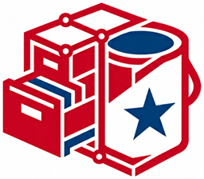

# Sistema de Gestión e Inventario de Activos IT - ActivosIT




## Datos del Proyecto
- **Autor:** Jose Ramon Hernandez Espinal
- **Supervisor:** Ing. Luis Suazo
- **Institución / Empresa:** Pinturas Americanas
- **Estado Actual:** Etapa de Análisis y Alcance (Fase Teórica y Prototipado)

## Tecnologías y Arquitectura
- **Backend:** PHP 7.4+ (probado en 8.2) + Composer, arquitectura MVC con PSR-4.
- **Base de Datos:** MySQL 8.0 / MariaDB 10.4 (21 tablas, InnoDB, borrado lógico en las entidades de negocio).
- **Frontend:** HTML5, CSS3, JavaScript puro, Bootstrap 5 y Font Awesome.
- **Entorno de Desarrollo:** XAMPP (Apache + MySQL) o el servidor embebido de PHP.
- **Control de Versiones:** Git + GitHub / GitKraken.

## Problema Planteado
La administración de la infraestructura tecnológica requiere un control estricto. Actualmente, la falta de un registro centralizado para gestionar el hardware, los componentes, las asignaciones a empleados y los mantenimientos genera inconsistencias en las existencias, falta de trazabilidad y dificultades para la auditoría técnica y financiera del departamento de IT.

## Solución Tecnológica
Desarrollo de un sistema web integral bajo el patrón de diseño **MVC** que automatiza y digitaliza los flujos operativos del departamento de IT.
**Destaca por:** control estricto de Kardex, gestión dual (artículos por cantidad y equipos físicos por número de serie), trazabilidad mediante bitácora de auditoría y un despliegue local ágil y seguro.

---

## Puesta en marcha (local)

### 1. Requisitos
| Componente | Versión mínima |
|---|---|
| PHP | 7.4 (recomendado 8.2) con `pdo_mysql`, `json`, `mbstring`, `dom`, `iconv`, `zip`, `openssl` |
| MySQL / MariaDB | 5.7 / 10.4 |
| Composer | 2.x |

Con XAMPP basta con tener Apache y MySQL activos; PHP también puede ejecutarse por CLI.

### 2. Dependencias
```bash
composer install
```
Si `vendor/` no existe la aplicación muestra un error explícito: es obligatorio ejecutar `composer install`.
La instalación incluye **Dompdf** para la exportación PDF; el Excel se genera con `ZipArchive` (`ext-zip`).

### 3. Configuración del entorno
`parameters.env` **no se versiona** (está en `.gitignore`) y debe mantenerse fuera del
`DocumentRoot` en producción. Créelo a partir de una copia local de la plantilla:

```bash
# Windows
copy renameTo_parameters.env parameters.env

# Linux / macOS
cp renameTo_parameters.env parameters.env
```

Ajuste como mínimo:

```ini
DB_SERVER = 127.0.0.1
DB_PORT = 3306
DB_USER = root
DB_PSWD =
DB_DATABASE = activosit
PWD_HASH = <cadena aleatoria de 64 caracteres>
DEVELOPMENT = 1
```

`PWD_HASH` es obligatorio y no puede quedar vacío. Genérelo con:

```bash
php -r "echo bin2hex(random_bytes(32)), PHP_EOL;"
```

### 4. Base de datos
Ejecute los scripts **en orden**:

```bash
mysql -u root -p < docs/scripts/00_database.sql
mysql -u root -p activosit < docs/scripts/01_security.sql
mysql -u root -p activosit < docs/scripts/02_catalogos.sql
mysql -u root -p activosit < docs/scripts/03_articulos.sql
mysql -u root -p activosit < docs/scripts/04_equipos.sql
mysql -u root -p activosit < docs/scripts/05_inventario.sql
mysql -u root -p activosit < docs/scripts/06_operaciones.sql
```

> Para una base ya existente, **no vuelvas a ejecutar los scripts completos**: aplica solo las migraciones incrementales de permisos que correspondan (ver [Migraciones de permisos](#migraciones-de-permisos)). Así evitas sobrescribir datos y existencias.

En phpMyAdmin: pestaña **Importar** y seleccionar cada archivo en el mismo orden.

### 5. Ejecutar
Con Apache, apunte el *DocumentRoot* a la raíz del proyecto solo si aplica las reglas
de [`.htaccess`](.htaccess). En producción es preferible publicar únicamente el
front controller y los recursos estáticos, manteniendo `parameters.env`, `src/`,
`docs/`, `scripts/` y `vendor/` fuera del árbol público.
Con el servidor embebido de PHP:

```bash
php -S 127.0.0.1:8080 -t .
```

Luego abra `http://127.0.0.1:8080/index.php`.

### 6. Cuentas iniciales
El script `01_security.sql` no crea contraseñas predeterminadas. Después de
crear el esquema, genere las cuentas administrativas con contraseñas únicas y
privadas mediante el procedimiento de bootstrap definido por el responsable
de despliegue. No documente contraseñas operativas en el repositorio.

Las cuentas creadas por auto-registro reciben el rol **Público**, que solo
permite acceder a *Mi perfil*. Las cuentas privilegiadas deben crearse o
habilitarse únicamente durante el despliegue y sus contraseñas deben rotarse
si ya fueron expuestas.

### 7. Verificación rápida
```bash
composer lint        # o: php scripts/lint.php
```
Revisa sintaxis de todos los archivos PHP y JSON del proyecto.

### 8. Respaldo y restauración

El procedimiento documentado para respaldar y restaurar la base de datos,
validar hashes, probar una restauración aislada y conservar la evidencia se
encuentra en [docs/respaldo_restauracion.md](docs/respaldo_restauracion.md).

Los respaldos deben almacenarse fuera del repositorio y `parameters.env` no
debe incluirse en archivos compartidos. La primera restauración siempre debe
realizarse en una base de prueba separada antes de intervenir `activosit`.

---

## Control de acceso (RBAC)

El sistema usa tres tablas: `roles`, `permisos`, `roles_permisos` y `usuarios_roles`.

Cada fila de `permisos` tiene un `tipo_permiso`:

| Tipo | `nombre_permiso` contiene | Valida |
|---|---|---|
| `CTR` | Nombre completo del controlador, p. ej. `Controllers\Usuarios\Usuarios` | `Controllers\PrivateController` |
| `MNU` | Identificador del menú, p. ej. `Menu_Usuarios` | `Utilities\Nav` |
| `MNT` / `RPT` | Permisos de mantenimiento o reportes | Módulos pendientes |

Reglas:
- El rol **Administrador** (`id_rol = 1`) tiene acceso global.
- Todo controlador privado exige su permiso `CTR`, **incluso con `DEVELOPMENT = 1`**.
- `DEVELOPMENT = 1` solo automatiza el registro de permisos nuevos (los crea si no existen) y muestra todos los menús.
- Desactivar un permiso (`estado_permiso = 0`) bloquea el acceso sin borrar el registro.

---

## Alcance Funcional

### Implementado
- Autenticación con sesiones endurecidas, CSRF por formulario y contraseñas con `password_hash`.
- RBAC completo: usuarios, roles y permisos, con asignación desde la interfaz.
- Catálogo de artículos (cantidad y serie) con existencias derivadas del Kardex.
- Equipos individuales: series, código patrimonial, ubicación, garantía, motivo y estado operativo, con borrado lógico.
- Entradas de inventario con borrador, confirmación con Kardex y anulación con reverso de existencias.
- Salidas de inventario con borrador, confirmación con descuento de stock/Kardex, control de equipos serializados y anulación con reverso.
- Catálogos generales y operativos con borrado lógico.
- Navegación dinámica filtrada por permisos (`nav.config.json`).
- Perfil del usuario autenticado.
- Asignaciones formales y devoluciones con trazabilidad de custodios.
- Mantenimientos con recepción, servicio técnico y entrega.
- Centro de reportes, Kardex, equipos por custodio y reportes operativos detallados con exportación CSV, Excel y PDF.
- Bitácora de auditoría de solo lectura con filtros, detalle y exportación CSV.

### En diseño / pendiente
- Auditoría de consultas y exportaciones de reportes (opcional; hoy se auditan las operaciones que modifican datos y los eventos de autenticación).

> La existencia de un artículo **no se edita manualmente** después de crearlo: se calcula a partir de los movimientos de inventario.

### Entradas de inventario

Ruta **Inventario → Entradas** (`Inventario_Entradas`); permisos `CTR` 35 y 36.

- Documento maestro (`documentos_entrada`) con líneas (`detalles_entrada`) y correlativo automático `ENT-AAAA-####` según el año del movimiento.
- Flujo **BORRADOR → CONFIRMADO → ANULADO**:
  - Al confirmar se actualiza `articulos.existencia_actual` y se registra un movimiento `ENTRADA` por línea en `movimientos_inventario` (Kardex).
  - Al anular un documento confirmado se revierte el stock con movimientos `AJUSTE_NEGATIVO`; anular un borrador no afecta existencias.
- Las líneas de artículos controlados por serie exigen un equipo disponible del mismo artículo y cantidad 1. Las líneas por cantidad no llevan equipo.
- El proveedor es obligatorio en tipos de documento de compra; el motivo es opcional y debe aplicar a entradas (`AJUSTE_ENTRADA`).
- El listado permite buscar por correlativo, proveedor, observaciones o tipo, filtrar por estado y tipo de documento, y ordenar por documento, fecha o estado.

### Salidas de inventario

Ruta **Inventario → Salidas** (`Inventario_Salidas`); permisos `CTR` 37 y 38.

- Documento maestro (`documentos_salida`) con líneas (`detalles_salida`) y correlativo automático `SAL-AAAA-####` según el año del movimiento.
- Flujo **BORRADOR → CONFIRMADO → ANULADO**:
  - Al confirmar se descuenta `articulos.existencia_actual` y se registra un movimiento `SALIDA` por artículo en `movimientos_inventario` (Kardex).
  - Al anular un documento confirmado se devuelve el stock con movimientos `AJUSTE_POSITIVO`; anular un borrador no afecta existencias.
- Las líneas de artículos controlados por serie exigen un equipo `DISPONIBLE`, del mismo artículo, no usado en otra salida confirmada y cantidad 1. Las líneas por cantidad no llevan equipo.
- Al confirmar, los equipos serializados pasan a `ASIGNADO` si el tipo de documento es de asignación (por ejemplo, «Despacho para asignación») o a `DE_BAJA` en caso contrario. Si el motivo aplica a `BAJA`, se guarda en el equipo. Al anular se liberan a `DISPONIBLE` y se limpia el motivo.
- El destino es obligatorio; la autorización y el motivo son opcionales. Los motivos disponibles son los que aplican a `AJUSTE_SALIDA` o `BAJA`.
- El listado permite buscar por correlativo, destino, autorización, observaciones o tipo, filtrar por estado y tipo de documento, y ordenar por documento, fecha o estado.

### Centro de reportes

Rutas **Reportes → Centro de reportes** (`Reportes_Reportes`), **Kardex** (`Reportes_Kardex`) y **Equipos por custodio** (`Reportes_EquiposCustodio`); permisos `Menu_CentroReportes`, `Menu_Kardex`, `Menu_EquiposCustodio` y los `CTR` de cada controlador.

- Indicadores generales de inventario, equipos, movimientos y asignaciones en el Centro de reportes.
- Kardex filtrable por fecha, tipo, artículo y texto; Equipos por custodio filtrable por texto y departamento.
- Gráficos con Chart.js 4.4.4 servido localmente desde `public/js/vendor/chart.umd.min.js`; no requiere CDN. En Kardex y Equipos por custodio respetan los filtros activos.
- Exportación CSV, Excel (`.xlsx`) y PDF de cada reporte. En Kardex y Equipos por custodio las descargas incluyen los filtros aplicados; el Centro exporta el resumen general.
- Reportes operativos detallados (`Reportes → Reportes operativos`) para inventario general, existencias, stock bajo, entradas, salidas, movimientos por artículo, equipos asignados, estados de equipos, asignaciones/devoluciones, mantenimientos, artículos por responsable, ajustes/bajas, movimientos por usuario y documentos.
- CSV con BOM UTF-8, separador `;` y saneo de fórmulas; Excel con una hoja por sección; PDF horizontal con Dompdf y numeración de páginas.
- Acceso para Administrador, Auditor y Técnico de Soporte; la bitácora de auditoría queda reservada a Administrador y Auditor.

Para una base existente, aplica `docs/scripts/11_reportes_permisos.sql` (idempotente).

### Migraciones de permisos

Si actualizas una base ya existente, no vuelvas a ejecutar los scripts completos. Aplica las migraciones incrementales en este orden:

```bash
mysql -u root -p activosit < docs/scripts/07_inventario_permisos.sql
mysql -u root -p activosit < docs/scripts/09_mantenimientos_permisos.sql
mysql -u root -p activosit < docs/scripts/10_asignaciones_permisos.sql
mysql -u root -p activosit < docs/scripts/11_reportes_permisos.sql
mysql -u root -p activosit < docs/scripts/12_auditoria_permisos.sql
mysql -u root -p activosit < docs/scripts/13_modelo_operativo.sql
mysql -u root -p activosit < docs/scripts/14_auditor_solo_consulta.sql
```

Todas son idempotentes y no modifican existencias, documentos ni eventos. La migración 13 agrega marca, modelo y observaciones de artículos, resultado y recomendaciones de mantenimiento, motivo de cancelación y accesorios entregados en asignaciones. La migración 14 retira los permisos de formulario del rol Auditor y lo deja en modo consulta. Cierra sesión y vuelve a entrar para refrescar el menú.

### Bitácora de auditoría

Ruta **Auditoría** (`Auditoria_Auditoria`); permisos `Menu_Auditoria` y `Controllers\Auditoria\Auditoria`.

- Consulta de solo lectura sobre la tabla `bitacora`, con filtros por texto, módulo, operación, resultado y rango de fechas.
- Resumen de eventos totales, exitosos, denegados y con error, calculado con los filtros activos.
- Detalle de cada evento con metadatos, dirección IP y los datos anteriores/nuevos en formato JSON.
- Exportación CSV de los eventos filtrados con BOM UTF-8, separador `;` y saneo de fórmulas.
- Instrumentación actual: inicio de sesión exitoso o denegado, cierre de sesión, alta de cuentas y operaciones de negocio sobre artículos, equipos, entradas, salidas, asignaciones, mantenimientos, catálogos y seguridad administrativa.

---

## 📁 Estructura del Proyecto
```text
ActivosIT/
├── index.php                  # Punto de entrada único (front controller)
├── nav.config.json            # Definición del menú público y privado
├── parameters.env             # Configuración local (NO se versiona)
├── renameTo_parameters.env    # Plantilla de configuración
├── composer.json
├── public/                    # CSS, imágenes y recursos estáticos
├── src/
│   ├── Controllers/           # Controladores MVC (públicos y privados)
│   ├── Dao/                   # Acceso a datos (PDO, sentencias preparadas)
│   ├── Utilities/             # Contexto, seguridad, navegación, validaciones
│   └── Views/                 # Motor de plantillas y vistas .tpl
├── scripts/
│   └── lint.php               # Verificación de sintaxis
└── docs/
    ├── respaldo_restauracion.md # Procedimiento de respaldo y recuperación
    ├── scripts/               # Scripts SQL base y migraciones incrementales
    └── migraciones/           # Instrucciones para aplicar cambios de BD
```
